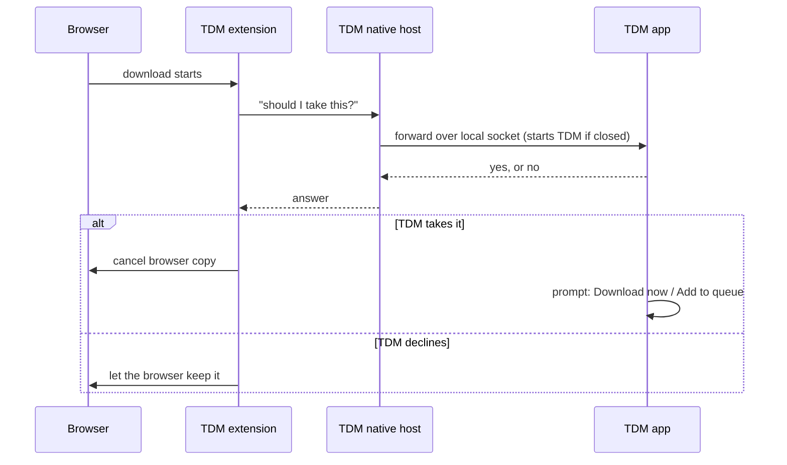

<h1 align="center">Turbo Download Manager (TDM)</h1>

<p align="center">
  A fast, segmented download manager for Windows, macOS and Linux,<br>
  with browser capture for Chrome, Edge, Brave, Vivaldi, Opera and Firefox.
</p>

<p align="center">
  <a href="LICENSE-MIT"></a>
  
  
  
  
</p>

---

## Table of contents

- [Features](#features)
- [Quick start](#quick-start)
- [Browser setup](#browser-setup)
- [How browser capture works](#how-browser-capture-works)
- [Keyboard shortcuts](#keyboard-shortcuts)
- [Command line](#command-line)
- [Configuration and data](#configuration-and-data)
- [Building from source](#building-from-source)
- [Testing](#testing)
- [Project layout](#project-layout)
- [Troubleshooting](#troubleshooting)
- [Contributing](#contributing)
- [Maintainers](#maintainers)
- [Licence](#licence)

---

## Features

<table>
  <tr>
    <th align="left">Area</th>
    <th align="left">What you get</th>
  </tr>
  <tr>
    <td><b>Downloads</b></td>
    <td>
      Multi-connection HTTP/HTTPS, pause and resume (state kept in a <code>.tdmstate</code> sidecar),
      FTP, and HLS/DASH media manifests saved as playable files.
    </td>
  </tr>
  <tr>
    <td><b>Queue and scheduling</b></td>
    <td>Max simultaneous downloads, a scheduler with start and stop times, and a global speed limit.</td>
  </tr>
  <tr>
    <td><b>Organising</b></td>
    <td>
      Automatic categories (Programs, Music, Video, Documents, Compressed), search,
      batch add such as <code>https://site/img[001-120].jpg</code>, and an opt-in clipboard watcher.
    </td>
  </tr>
  <tr>
    <td><b>Safety</b></td>
    <td>
      Verify SHA-256 against a published hash. Existing files are never overwritten: a name clash
      becomes <code>name (2).ext</code>. Deleting a download keeps its file unless you tick the box.
    </td>
  </tr>
  <tr>
    <td><b>Browser capture</b></td>
    <td>
      Takes over downloads from Chrome, Edge, Brave, Vivaldi, Opera and Firefox, asks what to do
      with each one, and starts TDM by itself if it is closed.
    </td>
  </tr>
  <tr>
    <td><b>Video helper</b></td>
    <td>A floating <b>⬇ TDM</b> button on videos, and a popup listing media on the current tab.</td>
  </tr>
  <tr>
    <td><b>Interface</b></td>
    <td>
      TDM Dark (default) and TDM Light with an animated toggle, download cards with progress bars,
      a live speed graph, toast notifications, and no redraws while idle.
    </td>
  </tr>
  <tr>
    <td><b>Proxy</b></td>
    <td>The Windows system proxy, or <code>HTTPS_PROXY</code>, <code>HTTP_PROXY</code> and <code>ALL_PROXY</code> elsewhere.</td>
  </tr>
</table>

---

## Quick start

1. **Install TDM** for your system (see the table below).
2. **Connect your browser** using the steps in [Browser setup](#browser-setup).
3. **Download something.** Click any file link in your browser, or paste a URL into TDM's top bar and press Enter.

<table>
  <tr>
    <th align="left">Operating system</th>
    <th align="left">Package</th>
    <th align="left">Notes</th>
  </tr>
  <tr>
    <td>Windows 10 / 11 (x64)</td>
    <td><code>tdm_&lt;version&gt;_x64-setup.exe</code><br>or <code>tdm_&lt;version&gt;_x64_en-US.msi</code></td>
    <td>The setup file installs for the current user only, with no administrator prompt.</td>
  </tr>
  <tr>
    <td>macOS 12+</td>
    <td><code>.dmg</code></td>
    <td>Drag TDM into Applications.</td>
  </tr>
  <tr>
    <td>Linux (x64)</td>
    <td><code>.deb</code>, <code>.rpm</code> or <code>.AppImage</code></td>
    <td>Needs the windowing libraries listed in <a href="#building-from-source">Building</a> when built from source.</td>
  </tr>
</table>

> **Note:** Windows may show a "Windows protected your PC" warning. Click **More info → Run anyway**. Releases are not code-signed yet.

---

## Browser setup

TDM does not need admin rights to connect to a browser. Use the sidebar to start:

1. Open TDM and click **Add** in the **BROWSERS** section of the sidebar.
2. In the page that opens, click **Add to Chrome** (or your browser).
3. TDM copies the extension folder path to your clipboard and opens the browser's extensions page.
4. On that page:
   1. Turn on **Developer mode** (top-right).
   2. Click **Load unpacked**.
   3. Press <kbd>Ctrl</kbd>+<kbd>V</kbd>, then click **Select Folder**.
5. The browser's status in TDM turns **Connected**.

<table>
  <tr>
    <th align="left">Browser</th>
    <th align="left">Supported</th>
    <th align="left">How the extension is loaded</th>
  </tr>
  <tr>
    <td>Chrome 102+</td>
    <td>Yes</td>
    <td>Load unpacked from <code>extension/dist/chrome</code></td>
  </tr>
  <tr>
    <td>Edge</td>
    <td>Yes</td>
    <td>Load unpacked from <code>extension/dist/chrome</code></td>
  </tr>
  <tr>
    <td>Brave, Vivaldi, Opera</td>
    <td>Yes</td>
    <td>Same as Chrome, on their extensions page</td>
  </tr>
  <tr>
    <td>Firefox 128+</td>
    <td>Yes</td>
    <td>
      Run <code>node extension/build.mjs</code>, then <b>Load Temporary Add-on</b> on
      <code>extension/dist/firefox/manifest.json</code> at <code>about:debugging</code>
    </td>
  </tr>
  <tr>
    <td>Safari</td>
    <td>No</td>
    <td>Requires an Xcode-packaged Safari extension</td>
  </tr>
</table>

### Private (Incognito) windows

The browser does not let an extension run in private windows until you allow it. Once, open the TDM card's **Details** on the extensions page and switch on **Allow in Incognito**. TDM cannot switch this on for you.

---

## How browser capture works



- The browser's own copy is cancelled only after TDM accepts the download.
- The local socket accepts connections from this machine only and requires a secret token.
- Captured files are named from the browser's suggested name, so no file is overwritten.

---

## Keyboard shortcuts

<table>
  <tr>
    <th align="left">Shortcut</th>
    <th align="left">Action</th>
  </tr>
  <tr><td><kbd>Ctrl</kbd>+<kbd>N</kbd></td><td>Focus the link bar</td></tr>
  <tr><td><kbd>Ctrl</kbd>+<kbd>F</kbd></td><td>Focus search</td></tr>
  <tr><td><kbd>Ctrl</kbd>+<kbd>Shift</kbd>+<kbd>V</kbd></td><td>Paste a link into the link bar</td></tr>
  <tr><td><kbd>Space</kbd></td><td>Pause or resume the selected download</td></tr>
  <tr><td><kbd>Delete</kbd></td><td>Remove the selected download</td></tr>
  <tr><td><kbd>Esc</kbd></td><td>Close the topmost menu or dialog</td></tr>
</table>

Shortcuts are ignored while you type in a text field.

---

## Command line

<table>
  <tr>
    <th align="left">Command</th>
    <th align="left">Purpose</th>
  </tr>
  <tr>
    <td><code>tdm</code></td>
    <td>Start the app, or bring the running window to the front</td>
  </tr>
  <tr>
    <td><code>tdm --register-host [ids...]</code></td>
    <td>Register the browser native host. With no ids, registers the bundled extension.</td>
  </tr>
  <tr>
    <td><code>tdm --unregister-host</code></td>
    <td>Remove the native host registration (used by the uninstallers)</td>
  </tr>
  <tr>
    <td><code>tdm --help</code></td>
    <td>Show usage</td>
  </tr>
</table>

---

## Configuration and data

<table>
  <tr>
    <th align="left">Item</th>
    <th align="left">Windows</th>
    <th align="left">macOS and Linux</th>
  </tr>
  <tr>
    <td>Settings and download list</td>
    <td><code>%APPDATA%\tdm\</code></td>
    <td><code>~/.config/tdm/</code></td>
  </tr>
  <tr>
    <td>Resume state</td>
    <td colspan="2"><code>&lt;file&gt;.tdmstate</code> beside each partial download</td>
  </tr>
  <tr>
    <td>Native host manifests</td>
    <td><code>%APPDATA%\tdm\com.tdm.host.json</code> plus per-user registry keys</td>
    <td>Browser <code>NativeMessagingHosts</code> folders under your user profile</td>
  </tr>
  <tr>
    <td>Start at login</td>
    <td>Per-user <code>Run</code> registry value</td>
    <td>Autostart desktop entry (Linux) or LaunchAgent (macOS)</td>
  </tr>
</table>

Nothing is written outside your user profile, and no administrator rights are needed.

---

## Building from source

**Requirements**

<table>
  <tr>
    <th align="left">Tool</th>
    <th align="left">Version</th>
  </tr>
  <tr><td>Rust (with Cargo)</td><td>1.85 or newer (edition 2024)</td></tr>
  <tr><td>Node.js</td><td>18 or newer (extension tests and build)</td></tr>
  <tr><td>cargo-packager (installers only)</td><td>0.11 or newer</td></tr>
</table>

**Commands**

```sh
cargo build --release            # target/release/tdm(.exe)
node extension/build.mjs         # extension/dist/chrome and extension/dist/firefox, plus zips

cargo install cargo-packager --locked
cargo packager --release --formats nsis,wix      # Windows installers
cargo packager --release --formats app,dmg       # macOS
cargo packager --release --formats deb,appimage  # Linux
```

**Linux system libraries** (for iced and wgpu):

```sh
sudo apt-get install -y pkg-config libxkbcommon-dev libwayland-dev libx11-dev \
  libxcursor-dev libxi-dev libxrandr-dev libfontconfig1-dev
```

Packaging details, including the `.rpm` build, are in [`packaging/README.md`](packaging/README.md).

---

## Testing

```sh
cargo test                # Rust unit and integration tests
cargo clippy --all-targets
node --test extension/    # extension unit tests
```

The integration tests start local HTTP and FTP servers, so they need no internet access.

For a manual check of the browser extension, follow [`extension/selftest.md`](extension/selftest.md).

---

## Project layout

<table>
  <tr>
    <th align="left">Path</th>
    <th align="left">Contents</th>
  </tr>
  <tr><td><code>src/engine.rs</code>, <code>ftp.rs</code>, <code>media.rs</code></td><td>Download engines</td></tr>
  <tr><td><code>src/main.rs</code>, <code>src/ui/</code></td><td>The iced interface: theme, icons, menus, dialogs</td></tr>
  <tr><td><code>src/ipc.rs</code>, <code>native_host.rs</code>, <code>register.rs</code></td><td>Browser bridge, single instance, host registration</td></tr>
  <tr><td><code>src/scheduler.rs</code>, <code>store.rs</code>, <code>model.rs</code></td><td>Schedule, persistence, settings</td></tr>
  <tr><td><code>extension/</code></td><td>Manifest V3 browser extension (Chrome, Edge, Firefox)</td></tr>
  <tr><td><code>packaging/</code></td><td>Installers, icon generators, desktop and metadata files</td></tr>
  <tr><td><code>assets/icons/</code></td><td>Interface icons (SVG)</td></tr>
</table>

---

## Troubleshooting

<table>
  <tr>
    <th align="left">Symptom</th>
    <th align="left">Fix</th>
  </tr>
  <tr>
    <td>The browser never shows <b>Connected</b></td>
    <td>Check that the extension is loaded and enabled, then reload it on the extensions page. Restart the browser if needed.</td>
  </tr>
  <tr>
    <td>Downloads from private windows are not captured</td>
    <td>Turn on <b>Allow in Incognito</b> for TDM on the extensions page.</td>
  </tr>
  <tr>
    <td>Chrome warns "Disable developer mode extensions" at startup</td>
    <td>Click <b>Cancel</b>. Unpacked extensions show this warning until they are published.</td>
  </tr>
  <tr>
    <td>The extension stops working after you move its folder</td>
    <td>Load it again from its new location.</td>
  </tr>
  <tr>
    <td>Windows blocks the installer</td>
    <td>Click <b>More info → Run anyway</b>. The installer is not code-signed yet.</td>
  </tr>
</table>

---

## Contributing

Issues and pull requests are welcome.

1. Fork the repository and create a branch from `main`.
2. Run `cargo test`, `cargo clippy --all-targets` and `node --test extension/` before you push.
3. Keep changes focused, and describe the behaviour you changed in the pull request.

By contributing you agree that your work is licensed under the same terms as the project (see [Licence](#licence)).

---

## Maintainers

<table>
  <tr>
    <th align="left">Name</th>
    <th align="left">Role</th>
  </tr>
  <tr><td>Bazil Suhail</td><td>Maintainer</td></tr>
  <tr><td>Abdullah Masood</td><td>Maintainer</td></tr>
</table>

---

## Licence

TDM is dual-licensed under either of

- the [MIT licence](LICENSE-MIT), or
- the [Apache Licence, Version 2.0](LICENSE-APACHE),

at your option.

Third-party crates and their licences are listed in [THIRD-PARTY-NOTICES.md](THIRD-PARTY-NOTICES.md).
