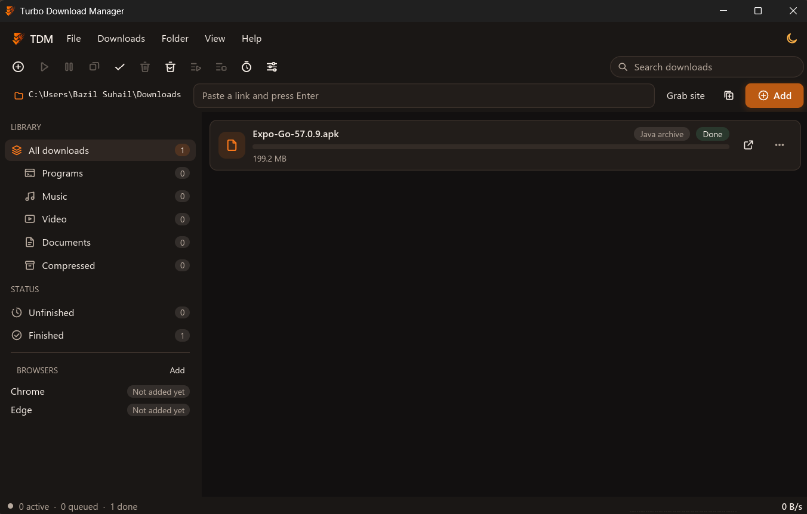

<p align="center">
  
</p>

<h1 align="center">Turbo Download Manager</h1>

<p align="center">
  <b>Split every download into parallel segments, resume what breaks, and capture files straight from your browser.</b>
</p>

<p align="center">
  <a href="https://github.com/BazilSuhail/Turbo-Download-Manager/releases/latest"></a>
  <a href="https://github.com/BazilSuhail/Turbo-Download-Manager/releases/latest"></a>
</p>

<p align="center">
  <a href="https://github.com/BazilSuhail/Turbo-Download-Manager/releases"></a>
  <a href="https://github.com/BazilSuhail/Turbo-Download-Manager/blob/main/LICENSE-MIT"></a>
</p>

| [Download](#download) | [Why Turbo](#why-turbo) | [Features](#features) | [Screenshots](#screenshots) | [Status](#status) | [For developers](#for-developers) |
| --- | --- | --- | --- | --- | --- |

## Why Turbo

Turbo is a desktop download manager written in Rust. It is built around three ideas:

- **Segments.** A large file is split into byte ranges that download in parallel, and each segment is isolated, so one failing connection does not stop the others.
- **Resume.** Interrupted downloads continue from where they stopped. Before resuming, TDM checks the server's `ETag` and `Last-Modified` headers, so a file that changed on the server is not stitched onto an old copy.
- **Capture.** A companion browser extension hands downloads and page media to the app, so you do not copy links by hand.

Turbo is open source under MIT OR Apache-2.0.

> [!NOTE]
> Turbo does not claim any particular speed against other download managers. How much it helps depends on the server, your connection and the file. Try it on the files you care about.

## Download

Get the installers from the [releases page](https://github.com/BazilSuhail/Turbo-Download-Manager/releases/latest).

| Platform | File | Notes |
| --- | --- | --- |
| Windows | `*-setup.exe` (NSIS) | Installs per user, with no UAC prompt. Registers the browser host after install. |
| Windows | `*.msi` (WiX) | Per-machine MSI. Each account registers its own browser host on first run. |
| Linux | `*.deb` | Debian and Ubuntu packages. The app writes its browser manifests on first start. |
| Linux | `*.AppImage` | Portable build, no install step. |
| Linux | `*.rpm` | Built with `cargo generate-rpm`. |
| Browser | Extension folders for Chrome and Firefox | Shipped beside the app. See [Browser extension](#browser-extension). |

> [!IMPORTANT]
> The installers are not code-signed yet. Windows SmartScreen may warn you. Choose **More info**, then **Run anyway**, only if you downloaded the file from the releases page above.

> [!WARNING]
> The release pipeline is paused. Release builds are not published from tags at the moment, so the links above may point to older builds, or to none. See [Status](#status).

### Browser extension

The extension works in Chrome, Edge, Brave, Vivaldi and Firefox. Opera reads Chrome's registration key, but it is not separately tested.

1. Start TDM. In the sidebar, under **BROWSERS**, click **Add**.
2. Choose your browser and click **Add to <browser>**. TDM copies the extension folder path and opens the extensions page.
3. Turn on developer mode, click **Load unpacked**, paste the path and select the folder.
4. The browser shows **Connected** in TDM once the native messaging host is registered.

The full walkthrough, with the right-click menu and the hover buttons, is in the [feature guide](docs/features-guide.md).

## Features

**Downloading**

- Segmented downloads over HTTP and HTTPS, with segments kept isolated from each other.
- Resume with `ETag` and `Last-Modified` checks.
- Automatic retries with growing delays (5 s, 10 s, 20 s, up to 5 minutes) for network errors and server errors such as 503. Permanent errors such as 404 are not retried.
- Per-host connection learning: TDM remembers how many connections a host accepts and shares that with other downloads.
- Disk-full handling: a download pauses with a reason instead of failing silently.
- Mirror URLs, and `[001-120]` or `[a-z]` ranges in batch links.
- Server hash checks: when the server sends a `Digest`, `Content-MD5` or `x-goog-hash` header, TDM checks the downloaded bytes against it.
- FTP for plain FTP servers.

**Browser capture**

- Chrome, Edge, Brave, Vivaldi and Firefox through the companion extension.
- Right-click **Download with TDM**, plus hover buttons on large images and on video and audio players that have a direct address.
- A capture prompt that lets you rename images and videos before they save, and choose the folder.

**Streaming media**

- HLS (`.m3u8`) and DASH (`.mpd`) manifests.
- DASH keeps audio and video apart. TDM joins them when `ffmpeg` is on your `PATH`; without it, the join step reports that ffmpeg was not found.

> [!NOTE]
> TDM does not download YouTube videos or DRM-protected streams, and it does not let you choose a stream quality from streaming sites yet.

**After the download**

- File-type check: TDM reads the first bytes of each finished file and warns when the content does not match the name, for example a ZIP named `setup.exe`. It also warns when a server returned a web page instead of the file.
- Scanner hook: after a download, TDM can run Windows Defender (`MpCmdRun.exe`) or ClamAV (`clamscan`) on the file.
- Duplicate file names: when a target name is taken, you can choose to ask, add a numbered name, overwrite, or open the complete dialog.

**Organising**

- Queues with schedules, and a time-of-day bandwidth cap.
- Site grabber: finds the files behind a web page. It stays on the start page's host, follows at most two levels of linked pages, obeys `robots.txt` and pauses between requests.
- Retry failed downloads with one shortcut, select and delete in bulk, rename before save.

**Network**

- Proxies: the system proxy, a manual proxy (with login), and PAC scripts evaluated in QuickJS. SOCKS proxies are supported.
- Proxy passwords and site secrets are stored in the OS keychain: Windows Credential Manager, the macOS Keychain, or the Linux Secret Service.

**Under the hood**

- Local IPC between the app and the browser host uses a freshly generated token, stored in a file only your user account can read.
- Logs are appended to `logs/tdm.log` in the app's folder.

For the step-by-step guide to these features, see [docs/features-guide.md](docs/features-guide.md).

## Screenshots

<p align="center">
  
</p>

## Status

Turbo is an early release, and the phases are still being completed. This is where things stand.

| Area | Status |
| --- | --- |
| Segmented HTTP and HTTPS downloads, resume, retries | Working |
| Browser capture (Chrome, Edge, Brave, Vivaldi, Firefox) | Working |
| HLS and DASH media | Working (DASH joining needs `ffmpeg`) |
| FTP | Working |
| Encrypted FTP (FTPS) | Not yet. Planned. |
| Archive extraction (zip, tar, gzip, xz) | In progress. The crates are in the build; the extraction step is not connected yet. 7z and rar will need 7-Zip. |
| Minimum-size capture filter | In progress. The protocol field exists but is not wired to the UI. |
| URL-level duplicate detection | Not yet. Only duplicate file names are handled. |
| Streaming sites (stream list and quality picker) | Planned |
| RSS feeds | In progress |
| Headless mode | In progress |
| Torrents | In progress |
| MCP server | In progress |
| Debrid services | In progress |
| Code signing for Windows installers | Not yet |
| Automated CI builds and release publishing | Paused. The workflows are kept in the repository, commented out. |
| Linux packages (deb, AppImage, rpm) | Configured in `Cargo.toml` and built by the release workflow when it is running. |

> [!NOTE]
> Items marked "in progress" are not connected to the app yet. Do not rely on them.

## For developers

<details>
<summary><b>Build from source</b></summary>

You need a recent stable Rust toolchain (the project uses edition 2024).

```sh
git clone https://github.com/BazilSuhail/Turbo-Download-Manager.git
cd Turbo-Download-Manager
cargo build --release
```

The binary is `target/release/tdm` (`tdm.exe` on Windows). The build copies the extension folders to `extension/dist/chrome` and `extension/dist/firefox`.

On Linux, install the windowing and GPU headers that iced needs:

```sh
sudo apt-get install -y pkg-config libxkbcommon-dev libwayland-dev libx11-dev \
  libxcursor-dev libxi-dev libxrandr-dev libfontconfig1-dev
```

Run the tests:

```sh
cargo test
```

Build installers with [cargo-packager](https://github.com/crabnebula-dev/cargo-packager):

```sh
cargo install cargo-packager --locked
cargo packager --release --formats nsis,wix      # Windows
cargo packager --release --formats deb,appimage  # Linux
```

For the rpm package, run `cargo install cargo-generate-rpm && cargo generate-rpm` after `cargo build --release`. The packaging details are in [packaging/README.md](packaging/README.md).

Register the browser host by hand, if needed:

```sh
tdm --register-host                 # bundled extension ids
tdm --register-host <chrome-id>...  # extra unpacked or development extension ids
tdm --unregister-host               # remove every manifest and registry key
```

</details>

### Layout

| Path | What it is |
| --- | --- |
| `src/` (package `tdm`) | The main app: the engine, planner, proxy, scheduler, browser host, IPC and the iced user interface (`src/ui/`). |
| `crates/tdm-store` | Durable JSON state files: atomic replace, lifecycle backups and corrupt-file recovery. |
| `crates/tdm-labserver` | Deterministic HTTP lab server with fault injection, used by the engine tests. |
| `crates/tdm-bench` | Black-box ranged-download benchmark run against `tdm-labserver`. |
| `tests/` | Integration tests: local HTTP, FTP and media servers. |
| `extension/` | The browser extension, built into Chrome and Firefox folders. |
| `packaging/` | Installer templates, icons and the packaging guide. |
| `docs/` | Feature guide and release notes. |

> [!TIP]
> Read [CONTRIBUTING.md](CONTRIBUTING.md) before opening a pull request.

## Licence and credits

Turbo Download Manager is dual-licensed under [MIT](LICENSE-MIT) or [Apache-2.0](LICENSE-APACHE), at your option.

Third-party components are listed in [THIRD-PARTY-NOTICES.md](THIRD-PARTY-NOTICES.md). Turbo is published by Entity Studios.
