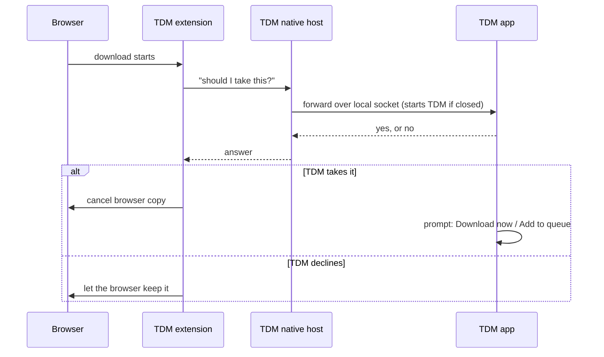

<p align="center">
  
</p>

<h1 align="center">Turbo Download Manager (TDM)</h1>

<p align="center">
  A fast, segmented download manager for Windows and Linux,<br>
  with browser capture for Chrome, Edge, Brave, Vivaldi, Opera and Firefox.
</p>

<p align="center">
  <a href="LICENSE-MIT"></a>
  
  
  
  
</p>

---

## Table of contents

- [Features](#features)
- [Comparison with IDM](#comparison-with-idm)
- [Quick start](#quick-start)
- [Browser setup](#browser-setup)
- [How browser capture works](#how-browser-capture-works)
- [Keyboard shortcuts](#keyboard-shortcuts)
- [Command line](#command-line)
- [Configuration and data](#configuration-and-data)
- [Building from source](#building-from-source)
  - [Set up from a fresh clone](#set-up-from-a-fresh-clone)
  - [Build commands](#build-commands)
- [Testing](#testing)
- [Releases and CI](#releases-and-ci)
- [Project layout](#project-layout)
- [Troubleshooting](#troubleshooting)
- [Contributing](#contributing)
- [Maintainers](#maintainers)
- [Licence](#licence)

---

## Features

<table>
  <tr>
    <th align="left">Area</th>
    <th align="left">What you get</th>
  </tr>
  <tr>
    <td><b>Downloads</b></td>
    <td>
      Multi-connection HTTP/HTTPS, pause and resume (state kept in a <code>.tdmstate</code> sidecar),
      FTP, and HLS/DASH media manifests saved as playable files. Add <b>mirror links</b> in the batch
      dialog: a segment that keeps failing moves on to them.
    </td>
  </tr>
  <tr>
    <td><b>Retries</b></td>
    <td>
      Temporary network errors (timeouts, dropped connections, HTTP 408, 429 and 5xx) are retried
      automatically, waiting 5 seconds and doubling each time up to 5 minutes. A download gets 3
      automatic retries by default; this is set in <code>settings.json</code>
      (<code>connection.auto_retry</code>, <code>connection.auto_retry_max</code>). Downloads that
      still fail stay in the list as Failed. <b>Retry failed downloads</b> (<kbd>Ctrl</kbd>+<kbd>R</kbd>)
      restarts them.
    </td>
  </tr>
  <tr>
    <td><b>Adding links</b></td>
    <td>
      Paste a link into the top bar and press Enter. Paste several links at once with
      <kbd>Ctrl</kbd>+<kbd>Shift</kbd>+<kbd>V</kbd> and they open in the batch dialog, ready to edit.
      With the clipboard watcher on (Preferences), a copied link is offered as a toast.
    </td>
  </tr>
  <tr>
    <td><b>Queue and scheduling</b></td>
    <td>
      Max simultaneous downloads, a scheduler with start and stop times, a global speed limit, and
      time-of-day speed windows (for example, a cap overnight) that override it while they are open.
      When the queue is done, the <b>After queue</b> setting in Preferences can keep TDM open, close
      it, or close it and shut the PC down about a minute later (Windows and Linux).
    </td>
  </tr>
  <tr>
    <td><b>Default folder</b></td>
    <td>
      The folder chip in the top bar shows where new downloads go. Click it, or use the
      <b>Folder</b> menu, to choose another one. <b>Open download folder</b> opens it in the file manager.
    </td>
  </tr>
  <tr>
    <td><b>Organising</b></td>
    <td>
      Automatic categories (Programs, Music, Video, Documents, Compressed), search (<kbd>Ctrl</kbd>+<kbd>F</kbd>),
      batch add such as <code>https://site/img[001-120].jpg</code>, and an opt-in clipboard watcher.
    </td>
  </tr>
  <tr>
    <td><b>Select and delete</b></td>
    <td>
      <kbd>Ctrl</kbd>+<kbd>A</kbd> switches on select mode, with a checkbox on each download. Tick
      the downloads you want and press <kbd>Delete</kbd>. The confirmation depends on the count:
      one download asks for a yes or no, a few idle downloads show a count and their names, and
      ten or more, any running download, or any file to remove needs the count typed in. Deleting
      a download keeps its file unless you tick <b>also delete the file</b>.
    </td>
  </tr>
  <tr>
    <td><b>Safety</b></td>
    <td>
      <b>Verify SHA-256 or MD5</b> on a finished download, against a published hash (a 64-character
      value is compared as SHA-256, a 32-character value as MD5). Existing files are never overwritten:
      a name clash becomes <code>name (2).ext</code>.
    </td>
  </tr>
  <tr>
    <td><b>File type check</b></td>
    <td>
      After a download finishes, TDM reads the first and last bytes of the file and compares them
      with the file name (on by default; turn it off in Preferences). If the content is an HTML or XML
      page, or a clearly different format, a warning offers <b>Open the page in browser</b>,
      <b>Rename to .ext</b> and <b>Keep</b>. Rename is offered only for clear mismatches, never for
      executables, and never overwrites an existing file. The detected type is saved with the download.
    </td>
  </tr>
  <tr>
    <td><b>Browser capture</b></td>
    <td>
      Takes over downloads from Chrome, Edge, Brave, Vivaldi, Opera and Firefox, asks what to do
      with each one, brings the TDM window to the front, and starts TDM by itself if it is closed.
    </td>
  </tr>
  <tr>
    <td><b>Video helper</b></td>
    <td>A floating <b>⬇ TDM</b> button on videos, and a popup listing media on the current tab.</td>
  </tr>
  <tr>
    <td><b>Keyboard</b></td>
    <td>
      Up and Down arrows, Home and End move through the list, Space pauses and resumes the selected
      download, and most actions have shortcuts. See <a href="#keyboard-shortcuts">Keyboard shortcuts</a>.
    </td>
  </tr>
  <tr>
    <td><b>Interface</b></td>
    <td>
      TDM Dark (default) and TDM Light with an animated toggle, download cards with progress bars,
      a live speed graph, toast notifications, and no redraws while idle. The sidebar widens with
      the window. Buttons are one solid colour, with white text on the accent in dark mode.
      The window reopens at its last size and position, unless that position is now off screen.
    </td>
  </tr>
  <tr>
    <td><b>Notifications</b></td>
    <td>
      When a download finishes while TDM is in the background, the taskbar button flashes. Turn this
      off with <b>Flash the taskbar when a download finishes</b> in Preferences (on by default).
    </td>
  </tr>
  <tr>
    <td><b>Proxy</b></td>
    <td>The Windows system proxy, or <code>HTTPS_PROXY</code>, <code>HTTP_PROXY</code> and <code>ALL_PROXY</code> elsewhere.</td>
  </tr>
</table>

<details>
<summary><b>How to add the browser extension (click to expand)</b></summary>

<br>

The extension lets your browser send downloads and video links to TDM. Do this once per browser.

1. **Build the extension folders.** `cargo build` does this automatically and creates
   `extension/dist/chrome` and `extension/dist/firefox`. If they are missing, run this in the project folder:

   ```sh
   node extension/build.mjs
   ```

   Node.js 18 or newer must be installed for this step.

2. **Start TDM.** In the sidebar, under **BROWSERS**, click **Add**.

3. **Pick your browser** and check its folder path in the list. Use **Copy path** to copy it,
   or **Open folder** to find it in Explorer.

4. **Click *Add to Chrome*** (or Edge, Brave, Vivaldi, Opera). TDM copies the path and opens the
   extensions page.

5. **Load the extension** on that page:
   - Turn on **Developer mode** (top-right).
   - Click **Load unpacked**.
   - Press <kbd>Ctrl</kbd>+<kbd>V</kbd>, then click **Select Folder**.

6. **Check the connection.** The browser's status in TDM changes to **Connected**.

**Firefox:** open `about:debugging#/runtime/this-firefox`, click **Load Temporary Add-on**, and pick
`extension/dist/firefox/manifest.json`. Firefox removes temporary add-ons when it restarts, so load it again.

**Private windows:** open TDM's **Details** for the extension and turn on **Allow in Incognito**.

**Not connected?** Reload the extension on its extensions page, then restart the browser. See
[Troubleshooting](#troubleshooting) for more.

</details>

---

## Comparison with IDM

Internet Download Manager (IDM) is the best-known Windows download manager. The table compares
TDM with IDM on the features people usually ask about. IDM details reflect its public documentation
at the time of writing; check the vendor's site for current pricing and features.

<table>
  <tr>
    <th align="left">Feature</th>
    <th align="left">TDM</th>
    <th align="left">IDM</th>
  </tr>
  <tr><td>Price</td><td>Free</td><td>Paid (free trial)</td></tr>
  <tr><td>Licence</td><td>MIT OR Apache-2.0, open source</td><td>Proprietary, closed source</td></tr>
  <tr><td>Windows</td><td>Yes</td><td>Yes</td></tr>
  <tr><td>Linux</td><td>Yes (packages built from source)</td><td>No</td></tr>
  <tr><td>Multi-connection downloads</td><td>Yes, configurable segments per file</td><td>Yes, dynamic segmentation</td></tr>
  <tr><td>Pause and resume</td><td>Yes</td><td>Yes</td></tr>
  <tr><td>FTP</td><td>Yes</td><td>Yes</td></tr>
  <tr><td>HLS / DASH streams</td><td>Yes, saved as a file</td><td>Yes, via the video grabber</td></tr>
  <tr><td>Scheduler and speed limit</td><td>Yes</td><td>Yes</td></tr>
  <tr><td>Queues</td><td>Yes</td><td>Yes</td></tr>
  <tr><td>Browser capture</td><td>Chrome, Edge, Brave, Vivaldi, Opera, Firefox</td><td>Chrome, Edge, Firefox and others</td></tr>
  <tr><td>Browser extension install</td><td>Manual (Load unpacked) for now</td><td>From the browser's add-on store</td></tr>
  <tr><td>Download prompt before starting</td><td>Yes: Download now or Add to queue</td><td>Yes</td></tr>
  <tr><td>Verify SHA-256 checksum</td><td>Yes</td><td>Not a headline feature</td></tr>
  <tr><td>Site grabber (download a whole site)</td><td>No</td><td>Yes</td></tr>
  <tr><td>Antivirus scan of finished files</td><td>No</td><td>Yes (integrated scan option)</td></tr>
  <tr><td>Batch add with patterns</td><td>Yes (<code>[001-120]</code>, <code>[a-z]</code>)</td><td>Yes</td></tr>
  <tr><td>Dark and light themes</td><td>Yes</td><td>Limited</td></tr>
  <tr><td>Source code you can read and change</td><td>Yes</td><td>No</td></tr>
  <tr><td>Track record and maturity</td><td>New, pre-release</td><td>Long-established</td></tr>
  <tr><td>Code-signed installer</td><td>Not yet</td><td>Yes</td></tr>
</table>

> [!NOTE]
> TDM is young. IDM has more years of use, more browser integrations and features such as the site
> grabber and antivirus scanning that TDM does not have yet. TDM's advantages are that it is free,
> open source, and runs on Linux as well as Windows.

---

## Architecture

TDM is one Rust crate that builds a single `tdm` binary. The GUI runs on the
[iced](https://iced.rs) toolkit, and the download work runs on Tokio.

| Layer | Where | What it does |
|---|---|---|
| Engine | `src/engine.rs` | Probes a URL, splits it into byte ranges, fetches them on concurrent workers that write at their true offsets, and checkpoints progress to a `.tdmstate` sidecar. One shared speed limiter caps the combined rate of all downloads. |
| Protocols | `src/ftp.rs`, `src/media.rs` | FTP with ranged `REST`/`RETR`. HLS and DASH manifests are expanded into segment lists before transfer. |
| Batch and crawl | `src/batch.rs`, `src/grabber.rs` | Expands `[001-120]`-style patterns, and collects linked files from one host. |
| Scheduling | `src/scheduler.rs`, `src/model.rs` | Queue start and stop windows, and time-of-day speed windows. |
| Post-download | `src/checksum.rs`, `src/scan.rs`, `src/filetype.rs` | One pass computes SHA-256 and MD5. Defender or ClamAV can scan the finished file. The file-type check sniffs the file's first and last bytes against its name. |
| Persistence | `src/store.rs` | `settings.json` and `downloads.json` in the per-user config folder, written to a temp file and then renamed. |
| Browser bridge | `src/ipc.rs`, `src/native_host.rs`, `src/register.rs` | A loopback TCP link between the browser's native-messaging host and the running app, with a per-run token. The host writes the browser manifests and, on Windows, the registry keys. |
| Interface | `src/main.rs`, `src/ui/` | The iced window, the menu, the Preferences dialog and the TDM Dark and Light themes. |
| Extension | `extension/` | A Manifest V3 extension that hands downloads and page media to TDM. |

State is plain JSON, so it is easy to inspect and back up. There is no
database to run.

## Quick start

1. **Install TDM** for your system (see the table below).
2. **Connect your browser** using the steps in [Browser setup](#browser-setup).
3. **Download something.** Click any file link in your browser, or paste a URL into TDM's top bar and press Enter.

<table>
  <tr>
    <th align="left">Operating system</th>
    <th align="left">Package</th>
    <th align="left">Notes</th>
  </tr>
  <tr>
    <td>Windows 10 / 11 (x64)</td>
    <td><code>tdm_&lt;version&gt;_x64-setup.exe</code><br>or <code>tdm_&lt;version&gt;_x64_en-US.msi</code></td>
    <td>The setup file installs for the current user only, with no administrator prompt.</td>
  </tr>
  <tr>
    <td>Linux (x64)</td>
    <td><code>.deb</code>, <code>.rpm</code> or <code>.AppImage</code></td>
    <td>Needs the windowing libraries listed in <a href="#building-from-source">Building</a> when built from source.</td>
  </tr>
</table>

> [!WARNING]
> Windows may show a "Windows protected your PC" warning. Click **More info → Run anyway**. Releases are not code-signed yet.

---

## Browser setup

> [!IMPORTANT]
> Keep the extension folder where it is. If you move or delete `extension\dist\chrome`, the browser
> loses its connection to TDM and you must load the new location again.

TDM does not need admin rights to connect to a browser. Use the sidebar to start:

1. Open TDM and click **Add** in the **BROWSERS** section of the sidebar.
2. In the page that opens, click **Add to Chrome** (or your browser).
3. TDM copies the extension folder path to your clipboard and opens the browser's extensions page.
4. On that page:
   1. Turn on **Developer mode** (top-right).
   2. Click **Load unpacked**.
   3. Press <kbd>Ctrl</kbd>+<kbd>V</kbd>, then click **Select Folder**.
5. The browser's status in TDM turns **Connected**.

<table>
  <tr>
    <th align="left">Browser</th>
    <th align="left">Supported</th>
    <th align="left">How the extension is loaded</th>
  </tr>
  <tr>
    <td>Chrome 102+</td>
    <td>Yes</td>
    <td>Load unpacked from <code>extension/dist/chrome</code></td>
  </tr>
  <tr>
    <td>Edge</td>
    <td>Yes</td>
    <td>Load unpacked from <code>extension/dist/chrome</code></td>
  </tr>
  <tr>
    <td>Brave, Vivaldi, Opera</td>
    <td>Yes</td>
    <td>Same as Chrome, on their extensions page</td>
  </tr>
  <tr>
    <td>Firefox 128+</td>
    <td>Yes</td>
    <td>
      Run <code>node extension/build.mjs</code>, then <b>Load Temporary Add-on</b> on
      <code>extension/dist/firefox/manifest.json</code> at <code>about:debugging</code>
    </td>
  </tr>
  <tr>
    <td>Safari</td>
    <td>No</td>
    <td>Requires an Xcode-packaged Safari extension</td>
  </tr>
</table>

### Private (Incognito) windows

> [!IMPORTANT]
> The browser does not let an extension run in private windows until you allow it. Once, open the TDM card's **Details** on the extensions page and switch on **Allow in Incognito**. TDM cannot switch this on for you.

---

## How browser capture works

> [!NOTE]
> By default every HTTP/HTTPS file download is captured. TDM then asks whether to **Download now** or
> **Add to queue**, and cancels the browser's own copy only after you choose.



- The browser's own copy is cancelled only after TDM accepts the download.
- The local socket accepts connections from this machine only and requires a secret token.
- Captured files are named from the browser's suggested name, so no file is overwritten.

---

## Keyboard shortcuts

> [!TIP]
> Press <kbd>Ctrl</kbd>+<kbd>N</kbd> to paste or type a link quickly, then press Enter to start it.

<table>
  <tr>
    <th align="left">Shortcut</th>
    <th align="left">Action</th>
  </tr>
  <tr><td><kbd>Ctrl</kbd>+<kbd>N</kbd></td><td>New download: move the cursor to the link bar</td></tr>
  <tr><td><kbd>Ctrl</kbd>+<kbd>Shift</kbd>+<kbd>V</kbd></td><td>Paste from the clipboard. One link goes into the link bar; several links open the batch dialog</td></tr>
  <tr><td><kbd>Ctrl</kbd>+<kbd>F</kbd></td><td>Search downloads: move the cursor to the search box</td></tr>
  <tr><td><kbd>Ctrl</kbd>+<kbd>A</kbd></td><td>Select downloads: turn on select mode and tick the downloads in view</td></tr>
  <tr><td><kbd>Ctrl</kbd>+<kbd>R</kbd></td><td>Retry failed downloads</td></tr>
  <tr><td><kbd>Ctrl</kbd>+<kbd>P</kbd></td><td>Pause everything while a download is running; otherwise start the queue</td></tr>
  <tr><td><kbd>Delete</kbd></td><td>Delete the ticked downloads if any are ticked, otherwise the selected download. Asks first</td></tr>
  <tr><td><kbd>F2</kbd></td><td>Show the selected download's file in its folder</td></tr>
  <tr><td><kbd>Up</kbd> / <kbd>Down</kbd></td><td>Select the previous or next download</td></tr>
  <tr><td><kbd>Home</kbd> / <kbd>End</kbd></td><td>Select the first or last download</td></tr>
  <tr><td><kbd>Space</kbd></td><td>Pause or resume the selected download. In select mode, tick or untick it</td></tr>
  <tr><td><kbd>Enter</kbd></td><td>Open a finished download's file. For any other download, does what Space does</td></tr>
  <tr><td><kbd>Esc</kbd></td><td>Close the topmost dialog or menu. With nothing open, leave select mode</td></tr>
</table>

The list shortcuts do nothing while a dialog is open. While a text field has focus, the keys the
field uses (letters, Space, arrows) go to the field, so they do not act on the list.

---

## Command line

<table>
  <tr>
    <th align="left">Command</th>
    <th align="left">Purpose</th>
  </tr>
  <tr>
    <td><code>tdm</code></td>
    <td>Start the app, or bring the running window to the front</td>
  </tr>
  <tr>
    <td><code>tdm --register-host [ids...]</code></td>
    <td>Register the browser native host. With no ids, registers the bundled extension.</td>
  </tr>
  <tr>
    <td><code>tdm --unregister-host</code></td>
    <td>Remove the native host registration (used by the uninstallers)</td>
  </tr>
  <tr>
    <td><code>tdm --help</code></td>
    <td>Show usage</td>
  </tr>
</table>

---

## Configuration and data

<table>
  <tr>
    <th align="left">Item</th>
    <th align="left">Windows</th>
    <th align="left">Linux</th>
  </tr>
  <tr>
    <td>Settings (<code>settings.json</code>)</td>
    <td><code>%APPDATA%\tdm\</code></td>
    <td><code>~/.config/tdm/</code></td>
  </tr>
  <tr>
    <td>Download list (<code>downloads.json</code>)</td>
    <td><code>%APPDATA%\tdm\</code></td>
    <td><code>~/.config/tdm/</code></td>
  </tr>
  <tr>
    <td>Resume state</td>
    <td colspan="2"><code>&lt;file&gt;.tdmstate</code> beside each partial download</td>
  </tr>
  <tr>
    <td>Native host manifests</td>
    <td><code>%APPDATA%\tdm\com.tdm.host.json</code> plus per-user registry keys</td>
    <td>Browser <code>NativeMessagingHosts</code> folders under your user profile</td>
  </tr>
  <tr>
    <td>Start at login</td>
    <td>Per-user <code>Run</code> registry value</td>
    <td>Autostart desktop entry (Linux)</td>
  </tr>
</table>

Each download record in `downloads.json` holds the URL, destination, category, headers, mirrors and
total size, plus the file type found by the file-type check (`kind`) and the Content-Type the server
sent. Both files are written to a temporary file first and then renamed, so an interrupted save
does not leave a broken file behind.

Nothing is written outside your user profile, and no administrator rights are needed.

---

## Building from source

### Set up from a fresh clone

**1. Install the tools (Windows)**

<table>
  <tr>
    <th align="left">Tool</th>
    <th align="left">Why</th>
    <th align="left">Get it</th>
  </tr>
  <tr>
    <td>Git</td>
    <td>Clone the repository</td>
    <td><a href="https://git-scm.com/download/win">git-scm.com</a></td>
  </tr>
  <tr>
    <td>Rust 1.85+ (rustup)</td>
    <td>Builds the app</td>
    <td><a href="https://rustup.rs">rustup.rs</a></td>
  </tr>
  <tr>
    <td>Visual Studio Build Tools, with the <b>Desktop development with C++</b> workload</td>
    <td>The Windows linker, the Windows SDK, and the resource compiler that embeds the icon in <code>tdm.exe</code></td>
    <td><a href="https://visualstudio.microsoft.com/visual-cpp-build-tools/">Visual Studio Build Tools</a></td>
  </tr>
  <tr>
    <td>Node.js 18+</td>
    <td>Builds the browser extension</td>
    <td><a href="https://nodejs.org">nodejs.org</a></td>
  </tr>
</table>

**2. Clone, run, and build the extension**

```sh
git clone https://github.com/BazilSuhail/Turbo-Download-Manager.git
cd Turbo-Download-Manager
cargo run                  # builds and starts TDM; the first build takes a few minutes
node extension/build.mjs   # creates extension/dist/chrome and extension/dist/firefox
```

Then, in TDM, click **Add** in the **BROWSERS** section and follow [Browser setup](#browser-setup).

**3. What git does and does not include**

<table>
  <tr>
    <th align="left">Item</th>
    <th align="left">In git</th>
    <th align="left">How it is created</th>
  </tr>
  <tr><td>Source code, tests, icons, logo, installer templates</td><td>Yes</td><td>Already in the clone</td></tr>
  <tr><td><code>Cargo.lock</code> (pinned crate versions)</td><td>Yes</td><td>Already in the clone</td></tr>
  <tr><td><code>target/</code> (compiled app)</td><td>No</td><td><code>cargo build</code> or <code>cargo run</code></td></tr>
  <tr><td><code>extension/dist/</code> (the folder to load in the browser)</td><td>No</td><td><code>node extension/build.mjs</code></td></tr>
  <tr><td><code>installer/</code> (setup files)</td><td>No</td><td><code>cargo packager --release --formats nsis</code></td></tr>
  <tr><td>Extension signing key</td><td>No, kept private</td><td>Needed only to publish the extension, never to build or run it</td></tr>
</table>

**Optional tasks**

```sh
cargo test && cargo clippy --all-targets   # check the code
node --test extension/                     # check the extension

pip install pillow && python packaging/make_logo.py   # regenerate all logo files from assets/tdm-logo.png

cargo install cargo-packager --locked
cargo packager --release --formats nsis    # Windows setup file
```

### Build commands

**Requirements**

<table>
  <tr>
    <th align="left">Tool</th>
    <th align="left">Version</th>
  </tr>
  <tr><td>Rust (with Cargo)</td><td>1.85 or newer (edition 2024)</td></tr>
  <tr><td>Node.js</td><td>18 or newer (extension tests and build)</td></tr>
  <tr><td>cargo-packager (installers only)</td><td>0.11 or newer</td></tr>
</table>

**Commands**

```sh
cargo build --release            # target/release/tdm(.exe)
node extension/build.mjs         # extension/dist/chrome and extension/dist/firefox, plus zips

cargo install cargo-packager --locked
cargo packager --release --formats nsis,wix      # Windows installers
cargo packager --release --formats deb,appimage  # Linux
```

`cargo build` (and `cargo run`) also builds the browser extension. The build script `build.rs` runs
`extension/build.mjs` with Node.js, so Node must be on your PATH. If Node is missing, the build still
succeeds and prints a warning, and you can run `node extension/build.mjs` yourself.

The icon is embedded in `tdm.exe` by the build script. The MSVC toolchain uses `rc.exe` through `winres`.
The GNU toolchain runs `windres` itself, from a short-path folder, because `windres` cannot handle spaces
in the project path. This needs 8.3 short names enabled on the drive. If no short path can be found,
the icon is skipped with a warning and the build still succeeds.

**Linux system libraries** (for iced and wgpu):

```sh
sudo apt-get install -y pkg-config libxkbcommon-dev libwayland-dev libx11-dev \
  libxcursor-dev libxi-dev libxrandr-dev libfontconfig1-dev
```

Packaging details, including the `.rpm` build, are in [`packaging/README.md`](packaging/README.md).

---

## Testing

```sh
cargo test                # Rust unit and integration tests
cargo clippy --all-targets
node --test extension/    # extension unit tests
```

The integration tests start local HTTP and FTP servers, so they need no internet access.

For a manual check of the browser extension, follow [`extension/selftest.md`](extension/selftest.md).

---

## Releases and CI

- **CI** (`.github/workflows/ci.yml`) builds the app in release mode on every push and pull request,
  on Windows and Ubuntu 22.04.
- **Release** (`.github/workflows/release.yml`) runs when you push a tag that starts with `v`, such as
  `v1.0.0`. The tag must match `version` in `Cargo.toml`, or the release stops. Tags with a hyphen
  (such as `v1.1.0-beta.1`) are published as pre-releases. See [docs/RELEASING.md](docs/RELEASING.md)
  for the full step-by-step guide.

Each release builds these installers and publishes them as a GitHub release:

- Windows: NSIS setup `.exe` and `.msi`
- Linux: `.deb`, `.AppImage` and `.rpm`

---

## Project layout

<table>
  <tr>
    <th align="left">Path</th>
    <th align="left">Contents</th>
  </tr>
  <tr><td><code>src/engine.rs</code>, <code>ftp.rs</code>, <code>media.rs</code></td><td>Download engines</td></tr>
  <tr><td><code>src/main.rs</code>, <code>src/ui/</code></td><td>The iced interface: theme, icons, menus, dialogs</td></tr>
  <tr><td><code>src/ipc.rs</code>, <code>native_host.rs</code>, <code>register.rs</code></td><td>Browser bridge, single instance, host registration</td></tr>
  <tr><td><code>src/scheduler.rs</code>, <code>store.rs</code>, <code>model.rs</code></td><td>Schedule, persistence, settings</td></tr>
  <tr><td><code>extension/</code></td><td>Manifest V3 browser extension (Chrome, Edge, Firefox)</td></tr>
  <tr><td><code>packaging/</code></td><td>Installers, icon generators, desktop and metadata files</td></tr>
  <tr><td><code>assets/icons/</code></td><td>Interface icons (SVG)</td></tr>
</table>

---

## Troubleshooting

<table>
  <tr>
    <th align="left">Symptom</th>
    <th align="left">Fix</th>
  </tr>
  <tr>
    <td>The browser never shows <b>Connected</b></td>
    <td>Check that the extension is loaded and enabled, then reload it on the extensions page. Restart the browser if needed.</td>
  </tr>
  <tr>
    <td>Downloads from private windows are not captured</td>
    <td>Turn on <b>Allow in Incognito</b> for TDM on the extensions page.</td>
  </tr>
  <tr>
    <td>Chrome warns "Disable developer mode extensions" at startup</td>
    <td>Click <b>Cancel</b>. Unpacked extensions show this warning until they are published.</td>
  </tr>
  <tr>
    <td>The extension stops working after you move its folder</td>
    <td>Load it again from its new location.</td>
  </tr>
  <tr>
    <td><code>link.exe</code> not found, or the build fails at linking</td>
    <td>Install the Visual Studio Build Tools with the <b>Desktop development with C++</b> workload, then open a new terminal.</td>
  </tr>
  <tr>
    <td>The first build is very slow</td>
    <td>Normal. Cargo downloads and compiles every crate once; later builds are much faster.</td>
  </tr>
  <tr>
    <td>"Extension files are missing from this install" when adding a browser</td>
    <td>Run <code>node extension/build.mjs</code> in the project folder, then try again.</td>
  </tr>
  <tr>
    <td>Windows warns when running a downloaded installer (SmartScreen)</td>
    <td>The installer is not code-signed yet. Click <b>More info</b>, then <b>Run anyway</b>.</td>
  </tr>
  <tr>
    <td>A download was saved as a web page</td>
    <td>
      The server sent an HTML page instead of the file, and the file-type check warned about it.
      Click <b>Open the page in browser</b> in the warning dialog to see what the server returned,
      then download again from a fresh link. <b>Keep</b> leaves the file as it is.
    </td>
  </tr>
</table>

---

## Contributing

Issues and pull requests are welcome.

1. Fork the repository and create a branch from `main`.
2. Run `cargo test`, `cargo clippy --all-targets` and `node --test extension/` before you push.
3. Keep changes focused, and describe the behaviour you changed in the pull request.

By contributing you agree that your work is licensed under the same terms as the project (see [Licence](#licence)).

---

## Maintainers

<table>
  <tr>
    <th align="left">Name</th>
    <th align="left">Role</th>
  </tr>
  <tr><td>Bazil Suhail</td><td>Author and maintainer</td></tr>
  <tr><td>Entity Studios</td><td>Publisher</td></tr>
</table>

---

## Licence

TDM is dual-licensed under either of

- the [MIT licence](LICENSE-MIT), or
- the [Apache Licence, Version 2.0](LICENSE-APACHE),

at your option.

Third-party crates and their licences are listed in [THIRD-PARTY-NOTICES.md](THIRD-PARTY-NOTICES.md).
